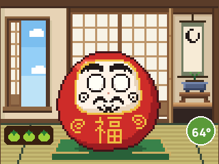
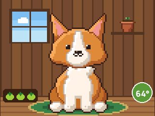
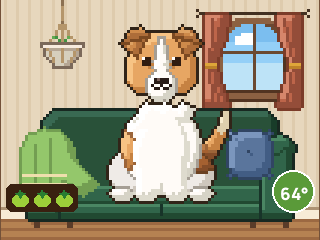
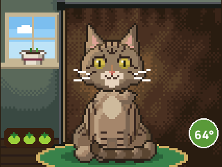
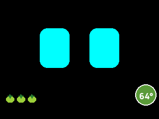
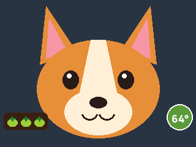
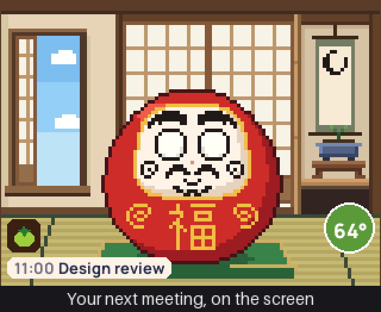

# Daruma
[](https://github.com/igrybkov/daruma/actions/workflows/ci.yml)

A small animated companion for your desk, built on
[ESPHome](https://esphome.io) and [Home Assistant](https://www.home-assistant.io).
It keeps you company while you work, runs your focus sessions, shows your
tasks, calendar and weather, answers by voice, and reacts to your home.
It runs on an [ESP32-S3-BOX-3](https://github.com/espressif/esp-box).

| | | |
|:-:|:-:|:-:|
| [](docs/gallery.md#daruma) | [](docs/gallery.md#pixel-corgi) | [](docs/gallery.md#jack-russell) |
| **Daruma** | **Pixel corgi** | **Jack Russell** |
| [](docs/gallery.md#tabby-cat) | [](docs/gallery.md#the-boss) | [](docs/gallery.md#eyes) |
| **Tabby cat** | **The Boss** | **Eyes** |
|  | [](docs/gallery.md#flat-corgi) |  |
|  | **Flat corgi** (pictures) |  |

Every persona shows every mood, reaction and activity the device knows:
the voice assistant, a focus block, the menu and apps in its own theme, a
message and a doorbell card. See them all in the
[gallery](docs/gallery.md).

Not just a pet: focus sessions, tasks, calendar, weather and questions
from Home Assistant.



## Why Daruma

**Room to grow.** The example build carries seven personas (five in pixel
art, the eyes and a picture persona), the voice assistant, every app,
Home Assistant prompts and the pomodoro. All of that takes 24% of the
firmware slot: 1.88 MiB of 7.75 MiB (1,973,411 of 8,126,464 bytes, ESPHome
2026.10.2). And you don't need all seven. Pick the personas you like and
include only those. The space you save is yours for whatever you want:
more personas, apps of your own, longer animations.

**Apps that come with it.**

- **Pomodoro**: one tap starts a focus block. A daily goal, breaks,
  tomatoes for the day, this week's bars and a streak.
- **Tasks**: today's tasks from a Home Assistant to-do list, or from a
  script that returns any task list. Tap one to check it off.
- **Calendar**: the Agenda of your coming events, and the next event on
  the persona's screen.
- **Weather**: now, today's high and low, rain, wind and the next hours.
- **Media**: a remote for the speakers and TVs in the device's room. The
  cover, the track, play, pause, skip and volume, for every player there.
  Put the buttons in a menu, or on a button of the device.
- **Prompts**: Home Assistant puts a card on the screen and gets the
  answer back: a doorbell with Unlock and Talk, a quiz with a countdown,
  a yes/no question. Start with the
  [prompt demos blueprint](#home-assistant-talks-to-it).
- **Voice assistant**: a wake word, or the top button, and Home
  Assistant's Assist.
- **Menus** you lay out yourself, with buttons that fire Home Assistant
  events.

**Plug in your own.** Personas, rooms, props, reactions, sounds, apps and
whole modules plug in from your own files or your own repository. The
build checks every part against every other, so a typo fails on your
computer and not on your desk. Start at
[docs/customize.md](docs/customize.md).

**Smooth, with a voice.** The pixel personas are drawn in Python at build
time and stored as keyframes and small patches: the pixel corgi's 41
frames take 13 KB. The screen redraws only the part that moved, at up to
10 frames a second, and the voice assistant runs alongside.

**Your look.** Every persona brings its own theme for the menu and apps:
wood, paper or outline, with your colors. Change the words in the menu
and apps, and rebind any button or gesture. Parts of the screen, such as
the timer or the temperature, open the menu or app you choose when you
tap them. Pick per-persona options in Home Assistant.

**Test it on your computer.** A desktop build runs Daruma in a window. A
fake clock makes every run draw the same frames, so golden pictures and a
pytest harness check the screens, and a 25-minute focus block takes a
second. The GIFs above come from it. `make desktop` opens the window,
and `make` lists every other task. See [docs/testing.md](docs/testing.md).

## Install

You need an ESP32-S3-BOX-3, Home Assistant, and
ESPHome 2026.10.2 or later.

1. Copy [examples/box3.yaml](examples/box3.yaml) into your ESPHome config
   folder. It has every public persona and every app.
2. Set the device name (`name` and `friendly_name`). Nothing else is
   required.
3. Add the keys from [examples/secrets.example.yaml](examples/secrets.example.yaml)
   to your `secrets.yaml`.
4. Compile and flash it over USB the first time.
5. Add the device in Home Assistant, and turn on "Allow the device to
   perform Home Assistant actions" in its options.
6. On the device's page in Home Assistant, pick your to-do list,
   calendars and weather entity. Put the device in an area, so the Media
   app finds the players in that room.

[docs/install.md](docs/install.md) has every step in detail, with links to
the ESPHome and Home Assistant docs.

The device file is short. It pulls the parts you list from this
repository. A smaller one, with two personas, looks like this:

```yaml
substitutions:
  name: daruma
  friendly_name: Daruma

packages:
  daruma:
    url: https://github.com/igrybkov/daruma
    ref: main            # pin a release tag or a full commit for a device you rely on
    files:
      - packages/board_box3.yaml
      - packages/core.yaml
      - packages/persona_daruma.yaml       # the first persona is the default
      - packages/persona_pixel_corgi.yaml
      - packages/menu.yaml
      - packages/pomodoro.yaml
      - path: packages/app_calendar.yaml
        vars: { calendars: calendar.home }
      - packages/prompts.yaml
```

Every persona you include shows up in the "Persona" select on the
device's page in Home Assistant. The first one in the list is the
default on a new device, and the device keeps your choice across reboots
and updates. On the device, swipe left or right on the screen to change
the persona. Those swipes run `daruma.next_persona` and
`daruma.previous_persona`, which you can bind to a button too. Drop a
line from `files:` to drop that part.

**Or let your agent do it.** Copy this prompt to your coding agent with
access to Home Assistant:

```text
Install Daruma (https://github.com/igrybkov/daruma) on my ESP32-S3-BOX-3
and connect it to my Home Assistant. Follow
https://github.com/igrybkov/daruma/blob/main/docs/agents/install.md and the
install guide it links. Before you start, ask me for the device name, my
Wi-Fi details, and which personas and apps I want. Tell me when I need to
plug in the device or click something.
```

## Home Assistant talks to it

**Try the prompt demos first.** Import the
[prompt demos blueprint](blueprints/script/prompt_demos.yaml), make a
script from it, and run it. In two minutes you see every kind of card the
device can show, and each answer coming back to Home Assistant.

| Blueprint | What it does | |
|---|---|---|
| [Prompt demos](blueprints/script/prompt_demos.yaml) (script) | Try every kind of card in two minutes: a yes/no question, an urgent alert, a card that stays, a scrolling list, two stacked alerts. The device shows the answer it sent back. | [](https://my.home-assistant.io/redirect/blueprint_import/?blueprint_url=https%3A%2F%2Fraw.githubusercontent.com%2Figrybkov%2Fdaruma%2Fmain%2Fblueprints%2Fscript%2Fprompt_demos.yaml) |
| [Doorbell prompt](blueprints/automation/doorbell_prompt.yaml) (automation) | When the doorbell rings, an urgent card offers Unlock, Talk and Ignore. | [](https://my.home-assistant.io/redirect/blueprint_import/?blueprint_url=https%3A%2F%2Fraw.githubusercontent.com%2Figrybkov%2Fdaruma%2Fmain%2Fblueprints%2Fautomation%2Fdoorbell_prompt.yaml) |
| [Quiz](blueprints/script/quiz.yaml) (script) | A quiz from your list of questions, with a score and a 50:50 button. | [](https://my.home-assistant.io/redirect/blueprint_import/?blueprint_url=https%3A%2F%2Fraw.githubusercontent.com%2Figrybkov%2Fdaruma%2Fmain%2Fblueprints%2Fscript%2Fquiz.yaml) |
| [Task list from a sensor](blueprints/script/task_list.yaml) (script) | Turns a list of tasks in a sensor attribute into a source for the Tasks app. | [](https://my.home-assistant.io/redirect/blueprint_import/?blueprint_url=https%3A%2F%2Fraw.githubusercontent.com%2Figrybkov%2Fdaruma%2Fmain%2Fblueprints%2Fscript%2Ftask_list.yaml) |

Your own automations call the device's actions. Each is
`esphome.<node>_<action>`, for example `esphome.daruma_show_message`:

| Action | What it does |
|---|---|
| `show_message(message, seconds)` | a speech bubble, with a chime |
| `prompt_show`, `prompt_update`, `prompt_close` | a card with buttons; the answer comes back as the event `esphome.daruma_prompt` |
| `ask` | a card that waits for the answer and returns it, for quick questions |
| `pomodoro_start(minutes)` | starts a focus block; `0` takes the focus setting |
| `menu_open(name)` | opens a menu |
| `wink()`, `add_happiness(change_by)`, `set_wellbeing(value)` | a wink, the mood, the plant's health |

The device tells Home Assistant what happens on it: the "Event" entity
fires `petted`, `scared` and `timer_finished`, menu buttons can fire
`esphome.daruma_menu`, and every setting is an entity. Cards, layouts and
examples: [docs/prompts.md](docs/prompts.md).

## Make a persona with your agent

Ask your agent to create a persona of your favorite character, animal,
flower, bird or imaginary friend:

```text
Create a Daruma persona of <your favorite character, animal, flower, bird
or imaginary friend>. Follow
https://github.com/igrybkov/daruma/blob/main/docs/agents/new-persona.md.
Show me the preview sheet before you build it, and record the showcase
GIFs when it is done.
```

## Philosophy

A [daruma](https://en.wikipedia.org/wiki/Daruma_doll) is a round Japanese doll that holds a goal. It comes with blank
eyes. You paint one eye when you set the goal, and the other when you
reach it. It is weighted at the bottom, so it stands back up when you
knock it over. The saying that goes with it is *nanakorobi yaoki*: "fall
down seven times, get up eight".

That is the idea here. Daruma keeps you company while you work towards
your goals, and celebrates when you get there. Miss a day, and tomorrow
you stand back up.

The default persona is a daruma. Its first eye fills in with the day's
first step, the second when you reach the day's goal. At midnight both
are blank again.

## Make it yours

Everything is a part you can swap, change or add to. The manual,
[docs/customize.md](docs/customize.md), covers each:

| Part | What you can do |
|---|---|
| [Personas](docs/customize.md#personas) | pixel art, pictures or eyes; behaviors, words and params per state |
| [Pets, rooms and props](docs/customize.md#pixel-art-pets-rooms-and-props) | a new breed in a few shapes and colors, a room of its own, a prop for focus |
| [States and reactions](docs/customize.md#states-what-the-device-can-show) | moods, activities and reactions with fallbacks, so a new persona works from one picture |
| [`during:`](docs/customize.md#reactions-during-an-activity-during) | reactions that keep the activity's props in the picture |
| [Sounds](docs/customize.md#sounds) | each persona's own chimes and yips, from a small synth |
| [Themes and words](docs/customize.md#themes-and-words) | the menu's style and colors per persona, every word in your language |
| [Apps](docs/customize.md#apps) | order, switches, copies for a second list or calendar, apps of your own |
| [Menus](docs/customize.md#menus), [bindings](docs/customize.md#buttons-and-gestures-bindings), [targets](docs/customize.md#parts-of-the-screen-that-lead-somewhere-targets) | which buttons, gestures and taps do what |
| [Signals](docs/customize.md#signals-progress-wellbeing-sky-goal) | grow the plant from anything Home Assistant knows |
| [Modules](docs/customize.md#your-own-module) | new states, actions and buttons in a few lines of YAML |
| [Prompts](docs/prompts.md) and [blueprints](#home-assistant-talks-to-it) | cards and questions from Home Assistant, ready to import |
| [Screens and boards](docs/customize.md#other-screens-and-boards) | wide, square, black and white, buttons only |
| [Your own repository](docs/private-packages.md) | keep personas and apps in a repository of your own, private or public |

How it fits together: [docs/architecture/](docs/architecture/README.md).

## Contributing

This repository is a starting point. Diverge from it as far as you like,
and send back what others could use: a persona, a room, an app, a board,
a fix. [CONTRIBUTING.md](CONTRIBUTING.md) has the setup, the checks and
the pull request checklist.

## License

MIT, see [LICENSE](LICENSE).

The hub and the eyes persona (`components/daruma`,
`components/daruma_eyes`) started from code by
[Rudy Gnodde](https://github.com/FamousWolf): an ESPHome component that
puts animated eyes on the ESP32-S3-BOX-3. See
[his original repository](https://github.com/FamousWolf/deskbuddy). His
code is under the MIT license. His notice is kept in those folders and in
[LICENSE](LICENSE). Thank you, Rudy.
