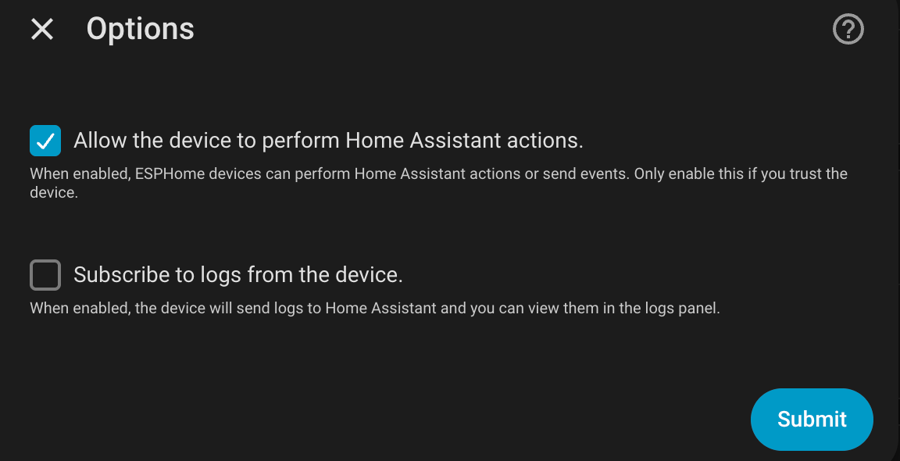

# Install Daruma

This guide takes you from a new ESP32-S3-BOX-3 to Daruma on your desk,
talking to Home Assistant. It takes about half an hour, most of it the
first compile.

If you use a coding agent with access to your Home Assistant, it can do
most of this for you. Give it the install prompt from the
[README](../README.md#install).

## What you need

- An [ESP32-S3-BOX-3](https://github.com/espressif/esp-box) and a USB-C
  data cable.
- [Home Assistant](https://www.home-assistant.io/installation/).
- ESPHome 2026.10.2 or later. Use the ESPHome Device Builder app in Home
  Assistant, or ESPHome on your computer. Both are described in
  [Install ESPHome](https://esphome.io/guides/installing_esphome/).
- For the voice assistant: an Assist pipeline in Home Assistant. See
  [Assist](https://www.home-assistant.io/voice_control/).

## 1. Make the device file

Daruma is a set of ESPHome packages. Your device file is short: it names
the device and lists the parts it wants. Everything else comes from this
repository at a git ref.

1. Open the ESPHome Device Builder and add a new device, or make an empty
   file in your ESPHome config folder. Call it `daruma.yaml`.
2. Copy [examples/box3.yaml](../examples/box3.yaml) into it.
3. Set `name` and `friendly_name` at the top. This is the only required
   change.

```yaml
substitutions:
  name: daruma
  friendly_name: Daruma
```

The file pulls the packages with ESPHome's
[remote packages](https://esphome.io/components/packages/#remotegit-packages).
It names `daruma_ref: main`. For a device you rely on, pin a release tag or
a full commit hash instead, and move it on when you want an update.

To leave a part out, delete its line from the `files:` list. Each package
says at its top what it needs. For example, `app_tasks.yaml` needs
`menu.yaml`.

## 2. Add the secrets

The device file reads four keys from `secrets.yaml` in your ESPHome config
folder. Copy them from
[examples/secrets.example.yaml](../examples/secrets.example.yaml) and fill
them in:

- `wifi_ssid` and `wifi_password`: your Wi-Fi.
- `wifi_fallback_password`: the password of the hotspot the device opens
  when it can't join your Wi-Fi.
- `daruma_api_key`: 32 random bytes, base64. Make one with
  `openssl rand -base64 32`. ESPHome rejects the all-zeros placeholder.

## 3. Compile and flash

The first install goes over USB. Plug the BOX-3 into the computer that
runs the browser or ESPHome.

- In the Device Builder: Install, then "Plug into this computer" or
  "Plug into the computer running ESPHome Device Builder".
- On the command line: `esphome run daruma.yaml`.

The first compile takes a while. It fetches this repository, draws the
pixel personas in Python, and builds the firmware. Later builds are faster.
Updates after this one go over Wi-Fi.

When it boots, the device shows "Waking up...", then "No Home Assistant"
until Home Assistant connects.

## 4. Add it to Home Assistant

Home Assistant finds the device on your network. Open Settings, Devices &
services, and add the discovered ESPHome device. It asks for the API key:
use your `daruma_api_key`. See the
[ESPHome integration](https://www.home-assistant.io/integrations/esphome/).

## 5. Allow Home Assistant actions

The Calendar, Tasks and Weather apps ask Home Assistant for data. A device
may do that only when you allow it.

1. Open Settings, Devices & services, ESPHome.
2. Select the cogwheel on your device's entry.
3. Turn on "Allow the device to perform Home Assistant actions".
4. Save.

The integration's [Options](https://www.home-assistant.io/integrations/esphome/#options)
section describes this switch.



## 6. Pick what the apps show

Open the device's page in Home Assistant. Under Configuration, set:

- **Tasks source** and **Tasks entity**: a to-do list (`todo.*`), or a
  script that returns tasks. The blueprint
  [task_list.yaml](../blueprints/script/task_list.yaml) makes such a
  script from a sensor attribute.
- **Calendars**: one or more calendar entities, comma-separated.
- **Weather entity**: the forecast for the Weather app and the
  temperature badge.

The device keeps these across reboots and updates. The `tasks_entity`,
`calendars` and `weather_entity` substitutions in the device file are only
starting values. A value you set in Home Assistant wins.

The same page has the other settings: the Persona select, the pomodoro
lengths and daily goal, one "App:" switch per app, the button bindings,
the window's sky, and each persona's own options.

<!-- TODO(screenshot): the device's page in Home Assistant, the
Configuration section, on a demo device. Crop out anything personal. Save
as docs/images/ha-device-settings.png and show it here. -->

> **Screenshot to come:** the device's settings page in Home Assistant.

## 7. Try it

- Tap the persona: the main menu opens. Tap More for the app board.
- Stroke the persona: it reacts to the pet.
- Press the red circle: the pomodoro menu. Focus starts a focus block.
- Press the top button and talk: the voice assistant.
- Pick another persona in the Persona select.

From Home Assistant, import the
[prompt demos blueprint](../blueprints/script/prompt_demos.yaml), make a
script from it and run it. It shows every kind of card the device can
show, and the answer each sends back.

[](https://my.home-assistant.io/redirect/blueprint_import/?blueprint_url=https%3A%2F%2Fraw.githubusercontent.com%2Figrybkov%2Fdaruma%2Fmain%2Fblueprints%2Fscript%2Fprompt_demos.yaml)

Then try the device's actions under Developer tools, Actions, for example
`esphome.daruma_show_message`. The [prompts guide](prompts.md) explains
the cards, with blueprints for a doorbell and a quiz.

## Troubleshooting

- **"No Home Assistant" stays on screen.** The device is on Wi-Fi but
  Home Assistant has not connected. Check the API key and that the device
  is added in the ESPHome integration.
- **The apps say they can't reach Home Assistant.** Turn on "Allow the
  device to perform Home Assistant actions" (step 5).
- **The build fails with a config error.** Daruma checks the whole config
  at build time: personas, states, bindings, menus and theme keys. The
  message names the problem and the choices there are.
- **Logs.** `esphome logs daruma.yaml`, or Logs in the Device Builder.

## Build from your own clone

The device file fetches the packages with git, so it builds what is
committed. To build against your clone or fork, commit, then override the
source:

```sh
esphome -s daruma_url file:///path/to/daruma -s daruma_ref main compile daruma.yaml
```

A short commit hash can't be fetched. Use a branch or the full hash.
